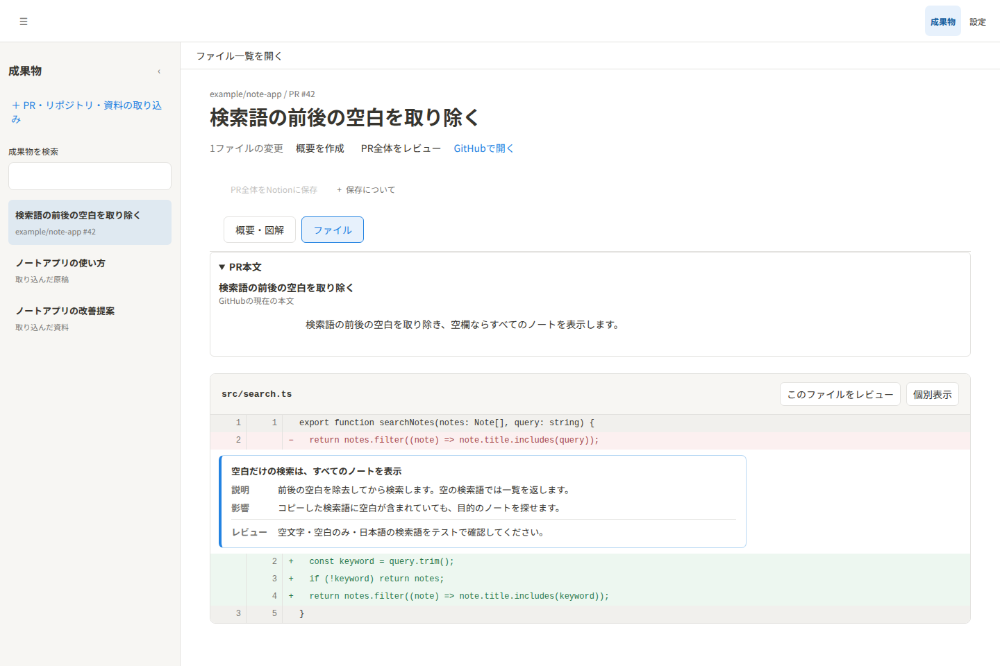

[日本語](README.md) | English

# xangi-studio

A [xangi](https://github.com/karaage0703/xangi) extension for reviewing PRs and documents and editing drafts.

<p>
  
  
</p>

Actual UI screenshots using a fictional note app's PR and slide deck. From top to bottom: PR diff and review; slide with page comments and document overview. Review comments are also dummy data, not actual AI output. See [Usage](docs/en/usage.md) for operation and the [testing guide](docs/en/testing.md#readme-screenshots) to reproduce the screenshots.

## Key features

- Import GitHub PRs, repositories, and documents
- Read diffs, AI reviews, and software overviews
- Edit and save drafts, and preview HTML
- Request work from xangi with your artifacts

## Quickstart

Requires Node.js 22.12 or later, xangi, and an authenticated GitHub CLI.

```bash
npm ci
npm run build
gh auth status
xangi extension link ./xangi-extension.json
xangi extension start xangi-studio
xangi extension doctor xangi-studio
```

After registration, open xangi-studio in the xangi Web UI.

## Documentation

- [Usage](docs/en/usage.md) — Setup and operation
- [Design](docs/en/design.md) — Architecture and data management

## Development

See the [testing guide](docs/en/testing.md) for development and validation details.

```bash
npm run format:check
npm test
npm run build
```

## License

[MIT](LICENSE)
