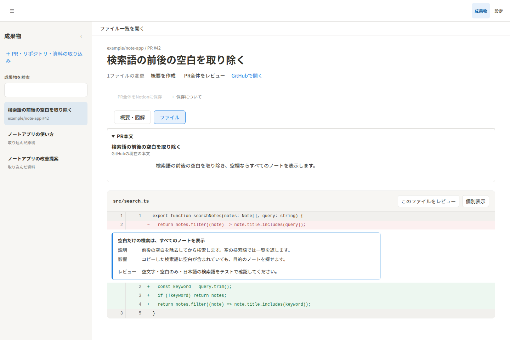
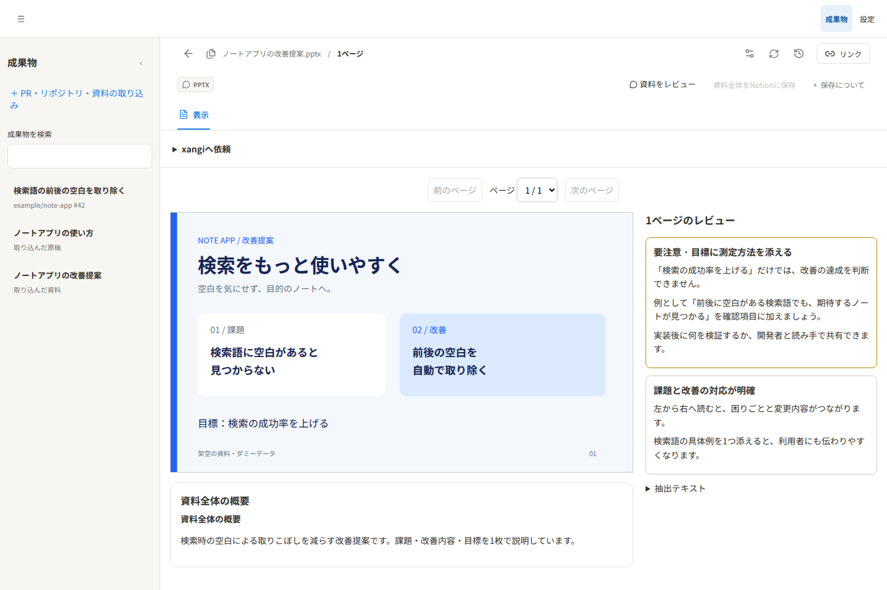

日本語 | [English](README.en.md)

# xangi-studio

[xangi](https://github.com/karaage0703/xangi)でPRや資料をレビューし、原稿を編集できる拡張機能です。

<p>
  
  
</p>

架空のノートアプリのPR・スライド資料を使った実画面です。上はPRの差分とレビュー、下はスライドとページ別レビュー・資料全体の概要です。レビュー文もダミーデータで、実際のAI出力ではありません。操作は[使い方ガイド](docs/usage.md)、再撮影は[検証ガイド](docs/testing.md#readme用スクリーンショット)をご覧ください。

## 主な機能

- PR・リポジトリ・資料の取り込み
- 差分・AIレビュー・概要の確認
- 原稿の編集・保存とHTMLプレビュー
- 成果物を添えたxangiへの作業依頼

## Quickstart

Node.js 22.12以降、xangi、認証済みのGitHub CLIが必要です。

```bash
npm ci
npm run build
gh auth status
xangi extension link ./xangi-extension.json
xangi extension start xangi-studio
xangi extension doctor xangi-studio
```

登録後はxangiのWeb UIで「xangi-studio」を開きます。

## ドキュメント

- [使い方ガイド](docs/usage.md) — 導入と操作
- [設計ドキュメント](docs/design.md) — 構成とデータ管理

## 開発

開発・検証の詳細は[検証ガイド](docs/testing.md)を参照してください。

```bash
npm run format:check
npm test
npm run build
```

## License

[MIT](LICENSE)
