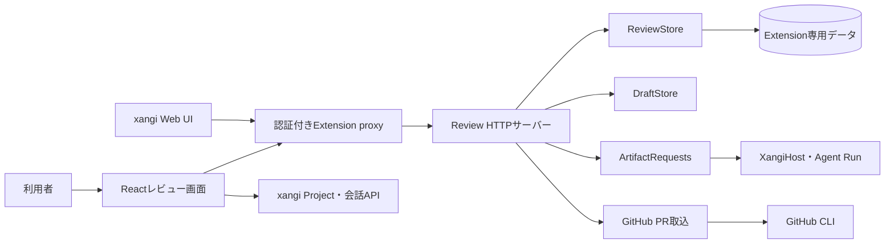

[English](en/design.md) | 日本語

# 設計ドキュメント

## 目的と範囲

xangi-studioは、変更ファイルの説明・コードレビュー・差分を同じ画面で確認するManaged Extensionです。GitHub PR・リポジトリ・PDF・Office・Google資料を取り込み、原稿の比較・編集と成果物からxangiへの依頼も同じ画面で扱います。

テキスト取り込み（workspace / github-pr / github-repository）は既定で編集可能。起動時に旧readOnly属性を移行し、ID・比較元・履歴は保つ。取り込みの識別はchangeSetで行い、編集権限と分離する。保存時は同じ版のchangeSetへeditRevisionを付け、説明・レビュー・概要を無効化する。レビュー回収はこの値も照合し、編集前の結果を拒否する。再取り込みは本文とeditRevisionを保持する。

## 構成

- `xangi-extension.json`と`scripts/xangi-extension`がManaged Extensionを宣言・起動します。
- `server/extension.mjs`はlocalhostの空きポートで待ち受け、xangiへready情報を返します。
- `server/http.mjs`は認証付きAPIと配信HTMLを提供します。
- `server/github-import.mjs`はPR情報・ファイルの取得とChange Setへの変換を担当します。
- `server/store.mjs`はレビュー、比較元、履歴、設定を保存します。`server/drafts.mjs`は編集途中の本文と更新時刻を保存します。
- `server/artifact-requests.mjs`と`server/xangi-host.mjs`は保存済み成果物をホストのAgent Runへ渡し、実行状況と結果を保持します。
- `src/main.tsx`と`src/ExplanationDiff.tsx`がPR一覧、説明カード、差分、相談操作を表示します。`src/api.ts`はReview APIとxangi APIへの接続を分離します。

ビルドではJavaScriptとCSSを`dist/index.html`へまとめます。これはxangi Extension UIのCSPに合わせるためです。

## PRの取込と版の更新

取込APIはジョブIDを即時返し、画面は状態をポーリングします。GitHub CLIは非同期で実行し、xangiの30秒のリクエスト制限を超えるPRでも画面と状態確認APIが応答できるようにします。同じPRの実行中ジョブは再利用します。

1. URLを`owner/repo/pull/number`として検証し、GitHub CLIの`gh api`からPRのbase/head SHAを取得します。
2. 保存済みの版と同じで、追加の`analysis`もなければ、ファイルの取得と保存を省略します。
3. 版が変わった場合は変更ファイルの前後のテキストを取得し、base/head SHAを含むパスへ、xangi-studio内の編集可能なコピーとして保存します。
4. 新版の全ファイルを取り込めた場合、旧版を一覧から隠します。旧版のファイルとレビューIDは保持し、既存リンクから参照できます。
5. `analysis`があればファイル別の説明・レビュー・警告を保存します。なければ差分情報から簡易説明を作ります。AIレビューは取り込み後に明示的に開始します。

`changeSet`のキーは種類・リポジトリ・PR番号で、版はbase/head SHAです。旧形式のHEADだけを含む保存パスは、初回の照合時に版情報を補完します。取得できないファイルがあれば`skipped`に理由を返し、旧版を一覧へ残します。GitHubへの書き込みは行いません。

PRのファイル一覧はGitHub APIから100件ずつページ取得する。3,000件に達した場合は不完全な取り込みを避けるため明示的に失敗する。ドットファイルとドットディレクトリを対象とし、`.env`も秘密情報の混入を見つけられるようレビュー対象にする。パストラバーサル、NUL、バイナリ、ファイル単位のサイズ制限は維持する。

## 保存と編集

Managed Extensionの既定保存先は`.state/managed-<instance>/`です。`XANGI_REVIEW_DATA_DIR`で変更できます。レビューのメタデータは`state/reviews.json`、レビュワー設定とアーカイブ設定は`state/preferences.json`、取り込んだテキストは`changes/`へ保存します。

ローカル開発用サーバーは`EDITOR_ROOT`配下だけを扱い、状態を`EDITOR_STATE_DIR`へ保存します。`begin`で固定した比較元と現在のファイルを表示します。手動保存APIは本文だけを受け取り、版照合や競合ロックを行わず、最後に保存した本文を採用します。更新は一時ファイルを書いてからrenameし、直近の保存前内容を履歴へ保持します。HTTPの保存APIは下書きも同じ本文へ更新します。SHA-256による内容の版はAI依頼や取込結果の判定に使い、手動保存を停止する条件にはしません。

パスの範囲外参照、隠しパス、シンボリックリンク、非UTF-8、NULを含む内容、256KBを超えるファイルを拒否します。PRから取り込んだレビューは保存APIでも閲覧専用です。

## レビュワーとUI

PR一覧で開始したレビューは取り込んだPR全体、ファイル画面で開始したレビューはそのファイルだけを対象にします。開始画面の指示は毎回空欄で、必要な指示とレビュワーを選びます。保存済みの指示は画面へ再表示しません。複数レビュワーはそれぞれ独立した会話で実行し、結果から元の会話へ戻れます。ファイル単位のジョブは対象外ファイルの結果を拒否します。

ファイル選択後は変更セット一覧を畳み、レビュー画面を全幅で表示します。説明欄も個別に開閉でき、スマートフォンでも初期状態で表示します。説明を選ぶと対応差分へ戻ります。警告レベルは`info`、`warning`、`danger`で表示し、色だけでなく文字でも区別します。

## 認証とAIレビュー

Extension APIはxangiの認証付き同一オリジンproxyから利用し、Bearer tokenを照合します。PRの取得に使うGitHub CLIは読み取り経路です。AIレビューはxangi Web Chatのセッションを使用し、エージェント未指定時は本体の既定設定に従います。JSONとして読めない結果や古いPR版への結果は保存しません。

### AIレビュー結果の保存と復旧

AIレビュー開始前に、PRの版とxangi会話IDを拡張へ保存します。拡張はその会話の保存済み結果を読み取り、現行のPR版へ反映します。画面の再読み込み・通信切断後も回収を続け、拡張の再起動後は保存した処理を再開します。画面にはレビュー中・完了・失敗と会話リンクを表示します。開始できなかった会話は2分、結果が届かない会話は1時間で失敗として表示し、「AIレビュー」から再実行できます。

Managed Extensionはxangiの`DATA_DIR/logs/sessions`（未指定時は起動workspaceの`.xangi/logs/sessions`）にある登録済み会話を読みます。独自のログ配置には対応しません。単独サーバーはAIレビュー結果の自動回収に対応しません。状態はExtension専用領域の`state/review-jobs.json`へ保存し、古いPR版の結果は適用せず失敗として残します。

## PDFとNotion

`server/documents.mjs`はPopplerを非同期の外部プロセスとして実行し、原本と最大1600pxのPNGをstate/documentsへ保存します（Popplerコードの同梱・コピーなし）。ページテキストとページ番号を持つ閲覧専用artifactレビューを全ページの変換完了後に一括登録します。AI回収は既存ReviewJobsを共用し、全ページ分の結果を要求します。画像は認証APIから取得しdata URLで表示するため、埋込proxyでもトークンをURLへ含めません。

PDFは384KiBずつBase64 JSONで送信し、ホストproxyの1MiB・テキスト本文制限内に収めます。アップロードと変換は同時に各1件、アップロードは5分で期限切れ、変換は202ジョブ応答後にポーリングします。変換ジョブはメモリ管理のため再起動復元なし。取込済み原本・画像・レビューは永続化されます。

`server/notion.mjs`は明示保存のみでNotion Create Page APIを呼び、サーバー環境変数の秘密をブラウザへ返しません。レビュー本文のスナップショットを内容hashで識別し、書込前のpendingと成功後のページURLを永続化します。通信結果不明時の再送を抑止します。API制限に収まらない場合は送信前に拒否し、部分的に保存した長文を成功と報告しません。

API仕様: <https://developers.notion.com/reference/post-page>、<https://developers.notion.com/reference/request-limits>。

## 資料変換と独立レビュー

`document-sources.mjs`はOffice文書を独立したLibreOfficeプロファイル（マクロ無効）でPDFへ変換します。入力に対応する形式の署名を検証し、原本を保持します。Googleはdocs.google.comのdocument/presentation URLからIDだけを抽出し、明示アカウントのgogでメタデータ取得・PDF出力を行います。任意URLのfetchは行いません。取得・変換も202ジョブで追跡します。

ジョブの重複抑止単位は対象版＋レビュワーID。会話と結果を独立させ、storeの排他書込でレビュワー別の結果を保持します。表示用指摘にはレビュワー名を付けて合成し、完了順に依存した上書きを防ぎます。画面は各レビュワーの最新ジョブを表示し、各成功時に結果を再取得します。レビューは明示的な実行操作で開始します。

仕様: <https://developers.google.com/workspace/drive/api/reference/rest/v3/files/export>、<https://help.libreoffice.org/latest/en-US/text/shared/guide/start_parameters.html>。

Notion保存はコード全文・画像hashを含めて内容を固定し、外部送信前にpendingを永続化します。PNGをアップロード後、ページ作成と分割追記を行い、全件成功後だけsavedにします。HTTPは保存ジョブIDを返し、画面で状態を取得します。再起動時に未完了保存を自動再送しません。

## 取り込み単位のレビューコンテキスト

`changeSet.reviewContext`に任意のテキストを保存する。各取り込みAPIで型と12,000文字の上限を検証し、ファイル分割アップロードは最初のチャンクの値を固定する。Google・資料の各ページは同一値を共有する。PRでは値の省略は既存指示の継承、空文字は解除を意味する。同じ版でも指示が変わればレビュー結果をクリアし、対象IDを返す。レビューの再実行は利用者が選ぶ。同じPRへの異なる指示の並行取り込みは409にする。

`shared/review-context.mjs`でPR・資料のプロンプトに同じ節を組み込み、JSON形式などの出力要件を保持する。ジョブの重複判定・登録・結果反映は版に加えて指示の一致を確認する。古いデータの値省略は空文字として扱う。UIは取り込み時に指示を送信しない。レビュー実行画面から `PUT /api/reviews/:id/context` で対象の版を照合して指示を保存し、保存済みの値からPR・資料のレビュープロンプトを生成する。古いクライアントの取り込みAPIは互換性のため指示を受け付ける。

## 成果物からxangiへの依頼

ArtifactRequestsはstate/artifact-requests.jsonへ対象reviewId・元の版・指示・依頼先・実行ID・会話ID・結果を保存します。GET /api/request-optionsで依頼先を取得し、GET/POST /api/reviews/:id/requestsで履歴取得と依頼を行います。POSTは4,000文字の上限、一意な受付ID、対象版、依頼先を検証します。同じ受付IDの異なる内容と実行中の重複依頼は409です。

保存済み本文と出典を添えてホストの通常のAgent Runを開始します。担当の権限と作業場所はホストが管理します。ブラウザからホストURLを指定することはできません。原本は自動更新せず、回答と出力先を会話で確認します。収集はブラウザに依存せず、再起動後も実行IDで再開します。送信前に受付状態を保存し、結果不明の受付は再送しません。進捗取得に失敗した実行は保持して再取得します。

## 画面設計の方針

既存の配色・書体・境界を使い、ファイル上部へ依頼フォームと状況・会話リンクを配置します。未反映の下書きがある間は依頼を無効にします。PC・スマホとも「成果物を開く→依頼先と指示を入力→状況・回答確認→一覧へ戻る」を同じ画面で行います。状態は文字でも示し、入力にラベル、エラーにrole=alertを付けます。

## 共通の成果物レイアウト

ArtifactLayoutが共通ナビ・検索可能なArtifactList・詳細領域を持ち、ホーム・レビュー・設定から共有する。各詳細の既存の未保存編集ガードを一覧からの遷移にも適用する。既存URLとブラウザ履歴を維持し、モバイルの一覧切替は詳細を再マウントしない。変更ファイル一覧は詳細内で開閉する。

### リポジトリスナップショット

`github-repository` はPRとは異なる取り込み種別で、sourceはowner/repo、idはref、revisionは解決したコミットSHAです。Git Treesとblob APIで同一版の内容を取得し、既存の非同期import job・ReviewStore・ReviewJobsを共有します。保存パスはsource/refのハッシュと完全SHAを含みます。全体表示のキーはSHAも含め、途中取得時に異なる版のファイルを混在させません。アーカイブはref単位です。

## PR・リポジトリの全体概要

概要生成とファイルレビューはReviewJobsの処理種別で分離します。概要は根拠ファイル・要素ID・件数・文字数を検査し、対象群の1ファイルにsoftwareOverviewとして保存します。レビューは担当ごとに最大3グループへ分割し、割当ファイルと結果が一致することを検証して成功分を個別に保存します。同じ版でのレビュー指示変更は概要を保持し、古い版の結果は拒否します。

SoftwareOverviewは既存CSSトークンとReactのテキスト描画で構成図・関係・根拠リンクを表示する。外部CDNや生成HTML実行・iframeに依存せずManaged Extensionでも使用可能。図に対応する説明を併記し、未確認の判断を承認済みと表示しない。PRの全体レビューは取込時のbase:headをプロンプトに固定する。

## 編集下書きと保存状態

`DraftStore`はstate/draftsへreviewの対象IDごとに本文と更新時刻を保存する。認証済み`GET/PUT/DELETE /api/drafts/:scope/:id`は対象の存在、閲覧専用属性、本文上限1MiBを検査する。保存と削除はプロセス内で直列化し、複数画面の保存は後の保存を採用する。版照合・競合ロック・旧版の互換処理は持たない。下書きだけでは実ファイル・履歴やAI実行を変更しない。

`useDraftAutosave`はブラウザの未保存本文コピー、800msの遅延保存、focusout・visibilitychange・Ctrl/Cmd+Sでの送信を扱う。通信は15秒でタイムアウトし、保存中の追加入力は後続保存する。再読込時は未保存の復旧本文を復元し、そのまま下書きへ保存する。版不一致で停止しない。コピーは保存成功後に削除し、別画面が書き換えたコピーは削除しない。

「保存」は下書き送信を前提条件にせず、`PUT /api/reviews/:id`へ本文だけを送る。ReviewStoreは保存前の本文を履歴に残してから書き込み、APIは下書きも同じ本文へ更新する。成功した明示保存は先行する下書き通信の失敗より優先する。通信・ファイル書込に失敗した場合は本文を残して再試行できる。

`DraftStatusBar`は状態・文字数・保存ボタンを表示する。通常の保存に復旧・載せ直し・コピー操作を要求しない。実際の失敗時だけ再試行を表示する。800px以下では本文末尾に通常配置し、PC幅では下部固定表示。モバイル実機キーボードでの確認は別途必要。

## HTMLプレビューの隔離

`HtmlPreview`は認証APIから同一changeSet・revisionの登録済みCSS/JavaScript/SVGを取得し、inertな文書内でHTMLを組み立てます。外部スクリプトはdata URL化してdefer/asyncの順序を保ち、CSSとSVG参照を埋め込みます。xangi-studio本体のDOMへ取り込み文書を挿入しません。HTML描画には同一オリジン権限を与えないiframeを使用します。

認証付き`POST /api/html-previews`は最大1MBの組み立て済みHTMLをメモリへ保持し、192bitランダムな専用URLを返します。このURLは当該HTMLの読み取りだけが可能で、認証トークンやファイルシステム権限は持ちません。最大20件・10分で破棄され、再起動後は復元しません。プレビュー応答自体もCSP `sandbox allow-scripts`を持つため、直接URLを開いても親オリジンには昇格しません。CSPは外部接続・フォーム・子フレーム・workerを禁止し、インライン/dataスクリプトだけを実行します。親UIのCSPは緩和しません。関連ファイルは読み取り時に既存のパス・symlink・サイズ検査を通し、HTMLから任意パスを探索しません。

画面は既存のタブ・配色・余白を保ち、読み込み中/失敗状態・再読み込みボタン・iframeタイトルを付けます。通信は15秒で失敗表示になり、画面切替で中断します。外部依存とモジュール解決・ビルド実行は扱わず、単体HTMLを推奨します。

参考: [HTML Standardのsandbox](https://html.spec.whatwg.org/multipage/iframe-embed-object.html)、[CSP Level 3](https://www.w3.org/TR/CSP3/)。
