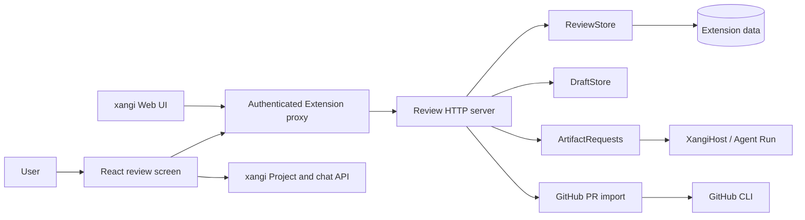

[日本語](../design.md) | English

# Design document

## Purpose and scope

xangi-studio is a Managed Extension for reading explanations, code review findings, and file diffs together. It imports GitHub PRs, repositories, PDF, Office and Google documents, and provides manuscript comparison, editing and requests to xangi in the same screen.

Text imports (workspace / github-pr / github-repository) are editable by default. Startup migrates legacy readOnly flags while preserving IDs, baselines and history. changeSet identifies imports independently of edit permissions. Saving assigns an editRevision to the imported revision and invalidates findings and overviews. Review collection also checks this token to reject results started before an edit. Reimports preserve content and editRevision.

## Architecture

- `xangi-extension.json` and `scripts/xangi-extension` declare and launch the Managed Extension.
- `server/extension.mjs` listens on a localhost ephemeral port and reports readiness to xangi.
- `server/http.mjs` serves the authenticated API and built UI.
- `server/github-import.mjs` reads PR metadata and files through GitHub CLI.
- `server/store.mjs` stores reviews, baselines, history, and preferences. `server/drafts.mjs` stores editing drafts and update timestamps.
- `server/artifact-requests.mjs` and `server/xangi-host.mjs` send saved artifacts to host Agent Runs and retain execution status and results.
- `src/main.tsx` and `src/ExplanationDiff.tsx` render the PR list, review cards, and diffs. `src/api.ts` keeps the Review and xangi transports separate.

The build inlines JavaScript and CSS into `dist/index.html` to satisfy the xangi Extension UI CSP.

## Import and revision checks

The import API immediately returns a job ID and the screen polls for its status. GitHub CLI runs asynchronously, keeping the screen and job status API responsive when an import exceeds xangi's 30 second request limit. Concurrent requests for the same PR reuse the running job.

1. Validate an `owner/repo/pull/number` URL and read the base and head commit SHAs through `gh api`.
2. When the stored revision matches and no new `analysis` is supplied, skip file downloads and writes.
3. Otherwise, fetch before and after text and store editable copies in xangi-studio under a path containing both SHAs.
4. After all files in the new revision are imported, hide the old revision from the list while retaining its files and review IDs for existing links.
5. Store supplied file level explanations and findings, or create brief fallback explanations. AI reviews start separately on explicit request.

A Change Set key includes source kind, repository, and PR number; its revision includes both SHAs. Older imports with only the head SHA are assigned revision metadata during their first check. Skipped files retain their reasons, and the old revision remains listed if the new import is incomplete. The import path never writes to GitHub.

Fetch all GitHub PR file pages in batches of 100. Report the 3,000-file API ceiling as an error rather than implying completeness. Include text dotfiles and dot directories, including `.env`, so accidental secret commits are visible. Preserve traversal, NUL, binary and per-file size checks.

## Persistence and editing

Managed Extension data defaults to `.state/managed-<instance>/` and can be moved with `XANGI_REVIEW_DATA_DIR`. Review metadata is stored in `state/reviews.json`, reviewer and archive preferences in `state/preferences.json`, and imported text in `changes/`.

The standalone server reads files only below `EDITOR_ROOT` and stores state under `EDITOR_STATE_DIR`. `begin` fixes a baseline before editing. Manual saves accept content only and use last-write-wins without version checks or conflict locks. Writes use a temporary file and rename, retaining the previous content in history. The HTTP save API also updates the draft to the same content. SHA-256 content revisions still identify AI request inputs and imported results, but do not block manual saves.

Paths outside the selected root, hidden paths, symlinks, invalid UTF-8, NUL content, and files over 256 KB are rejected. Imported PR reviews cannot be saved through the editing API.

## Reviewers and screen layout

Review from the PR list covers the imported PR; review from a file covers only that file. The instruction field starts empty and saved instructions are not redisplayed. The same dialog selects one or more reviewers. Each reviewer has a separate conversation, and completed findings link back to the conversation that produced them. File scoped jobs reject results for other files.

Selecting a file collapses the Change Set list and gives the review screen full width. The explanation panel can be toggled separately and starts visible on mobile. Findings use `info`, `warning`, and `danger`, with text labels as well as color.

## Authentication and AI reviews

The API is accessed through xangi's authenticated same-origin proxy and checks a Bearer token. GitHub CLI is used for read only PR access. AI review uses a xangi Web Chat session and inherits xangi's default settings when no Project is selected. Unparseable answers and results for stale PR revisions are not saved.

### AI review persistence and recovery

Before sending the review request, the UI registers its PR revision and xangi session ID with the extension. The extension collects the persisted assistant response and applies it only to that revision. Collection continues after browser disconnection or reload and resumes after extension restart. The UI displays running, completed, and failed states with a conversation link. A conversation that never starts fails after two minutes; a started conversation without a result fails after one hour. Use AI Review to retry.

The managed extension reads registered conversations from xangi’s `DATA_DIR/logs/sessions`, defaulting to `.xangi/logs/sessions` in the startup workspace. Custom transcript layouts and automatic collection in the standalone server are not supported. Jobs are persisted in the extension’s `state/review-jobs.json`. Stale PR results are rejected and retained as failed jobs.

## PDF and Notion

`server/documents.mjs` invokes installed Poppler executables asynchronously (no Poppler source is bundled), preserving the original PDF and rasterizing pages to PNG up to 1600px. All pages are committed as read-only artifact reviews only after conversion succeeds. ReviewJobs collects complete page results. Authenticated image requests become data URLs, keeping tokens out of image URLs and supporting the host CSP.

Uploads use 384KiB Base64 JSON chunks below the host proxy's 1MiB text-body limit. One upload and conversion run at a time; uploads expire after five minutes. Conversion returns a 202 job and is polled. Import jobs are memory-only and do not resume after a restart; committed documents and reviews persist.

`server/notion.mjs` sends explicit review snapshots to Notion Create Page using server-only credentials. A payload hash identifies each export. Pending state is persisted before a write and the result URL after success. Ambiguous writes block retries; oversized snapshots fail before sending, without reporting partial output as success.

References: <https://developers.notion.com/reference/post-page>, <https://developers.notion.com/reference/request-limits>.

## Document conversion and independent reviews

`document-sources.mjs` converts Office files through an isolated LibreOffice profile with macros disabled, validates format signatures and preserves originals. Google URLs are restricted to docs.google.com document/presentation paths; only the ID is passed to gog with an explicit account for metadata lookup and PDF export. No arbitrary URL fetching occurs. Conversion and export use 202 jobs.

Review deduplication uses revision plus reviewer ID. Sessions are independent; serialized store writes preserve reviewer-specific results, and display findings include reviewer names. Completion order does not discard another reviewer's findings. The UI shows each reviewer's latest job and reloads results after each completion. Reviews start only on explicit request.

References: <https://developers.google.com/workspace/drive/api/reference/rest/v3/files/export>, <https://help.libreoffice.org/latest/en-US/text/shared/guide/start_parameters.html>.

Notion rich exports: capture source and image hashes, persist pending before external writes, upload page PNGs, create a page and append bounded block batches. Only mark saved after every batch succeeds. HTTP returns a job ID and the client polls. Jobs run while the extension is alive; restart does not replay ambiguous writes.

## Import-scoped review context

Optional text is stored in `changeSet.reviewContext`. Import endpoints validate its type and 12,000-character limit; chunked uploads capture the value from the first chunk. All pages of a document share it. For PR imports, omission preserves existing context while an empty string clears it. A context change on an unchanged revision clears previous findings and returns the target IDs without starting a review. Concurrent imports of the same PR with different instructions return 409.

`shared/review-context.mjs` supplies a common context section for PR and document prompts while retaining required output formats. Job registration, deduplication, and result application compare both revision and context; missing values in legacy data are treated as empty. The UI sends no instructions during import. The review dialog saves instructions through `PUT /api/reviews/:id/context`, validating the imported revision before generating PR/document review prompts. Import APIs still accept context for older clients.

## Requests from the artifact screen

ArtifactRequests persists source ID/version, instructions, destination, run/session IDs and results in state/artifact-requests.json. GET /api/request-options lists destinations; GET/POST /api/reviews/:id/requests reads history or dispatches work. POST validates instructions (4,000 characters), receipt ID, source version and destination. Conflicting receipt contents and concurrent work on the same artifact return 409.

Saved source and provenance accompany a normal host Agent Run. The host owns agent permissions and workspaces; browsers cannot choose a host URL. Responses do not automatically overwrite sources. Server collection resumes from saved run IDs after restart. State is written before dispatch; unknown outcomes are never automatically resubmitted. Poll failures preserve the work for subsequent collection.

## UI design principles

The request form and conversation links appear above file content using existing theme tokens. Pending file drafts block requests. Desktop and mobile share the open/request/result/back flow. Inputs retain labels; status uses text and errors use role=alert.

## Shared artifact layout

ArtifactLayout provides navigation, the searchable ArtifactList and detail content for home, reviews and settings. Existing unsaved-edit guards also apply to artifact navigation. Preserve URLs and native browser history; mobile list switching keeps details mounted. The PR file tree toggles inside the detail pane.

### Repository snapshots

`github-repository` uses owner/repo as source, ref as id and a resolved commit SHA as revision. Git Trees/blob reads share asynchronous import jobs, ReviewStore and ReviewJobs. Storage paths include a source/ref hash and the full SHA. UI groups include the revision to avoid mixing partial snapshots; archiving operates per ref.

## PR and repository overviews

Overview generation and file review use separate ReviewJobs purposes. Overview jobs validate source paths, element IDs and size limits before ReviewStore stores softwareOverview on one file in the set. Review jobs partition files into at most three groups per reviewer, validate that each result exactly matches its assigned files, and save successful groups independently. Review instruction changes preserve the overview for the same revision; stale revisions are rejected.

SoftwareOverview uses existing CSS tokens and escaped React text for components, relationships and source buttons, with accompanying text. It requires no generated HTML execution, iframe, or external CDN and works inside Managed Extensions. Whole-PR review prompts pin the imported base:head revision.

## Editing drafts and save status

DraftStore persists content and an update timestamp per review ID. Authenticated GET/PUT/DELETE validate the target, read-only state and 1MiB limit. Writes and deletes are serialized per process and use last-write-wins. No version checks, conflict locks or legacy compatibility workflow remain. Draft-only writes do not change files, history or AI execution.

useDraftAutosave maintains unsaved browser text, debounces writes by 800ms and flushes on focusout, visibility changes and Ctrl/Cmd+S. Requests time out after 15 seconds. Edits during a write are saved next. Reload restores unsaved browser text and saves it without version comparison. Successful persistence clears only the matching recovery copy.

Save sends content directly to PUT /api/reviews/:id without requiring a successful draft request. ReviewStore keeps the previous file in history and writes the new text; the API also updates the draft. A successful explicit save supersedes failures of older draft requests. Actual transport or disk errors preserve the text for retry.

DraftStatusBar shows status, count and Save, with Retry only for actual failures. It uses normal flow after the document at widths up to 800px, and a fixed bottom position on desktop. Physical mobile keyboard behavior still requires device verification.

## HTML preview isolation

HtmlPreview reads registered CSS/JavaScript/SVG from authenticated APIs restricted to the same changeSet/revision and assembles an inert document. External scripts become data URLs to preserve defer/async semantics; CSS and SVG references are embedded. Imported nodes never enter the xangi-studio DOM. Rendering uses an iframe without same-origin privileges.

Authenticated POST /api/html-previews stores assembled HTML up to 1MB in memory and returns a dedicated 192-bit random URL. This grants access only to that snapshot, without authentication tokens or filesystem permissions. Snapshots expire after ten minutes, are capped at twenty, and do not survive restart. The response also carries CSP sandbox allow-scripts, so opening its URL directly cannot grant the parent origin. CSP blocks external connections, forms, nested frames and workers; only inline/data scripts run. The parent UI CSP is unchanged. Related files pass existing path, symlink and size checks; HTML cannot explore arbitrary filesystem paths.

The existing tabs, colors and spacing remain. Loading/error states, a reload button and an iframe title make state and actions explicit. Requests time out after fifteen seconds and abort on navigation. External dependencies, module resolution and project builds are not performed; prefer self-contained HTML.

References: [HTML Standard sandbox](https://html.spec.whatwg.org/multipage/iframe-embed-object.html), [CSP Level 3](https://www.w3.org/TR/CSP3/).
