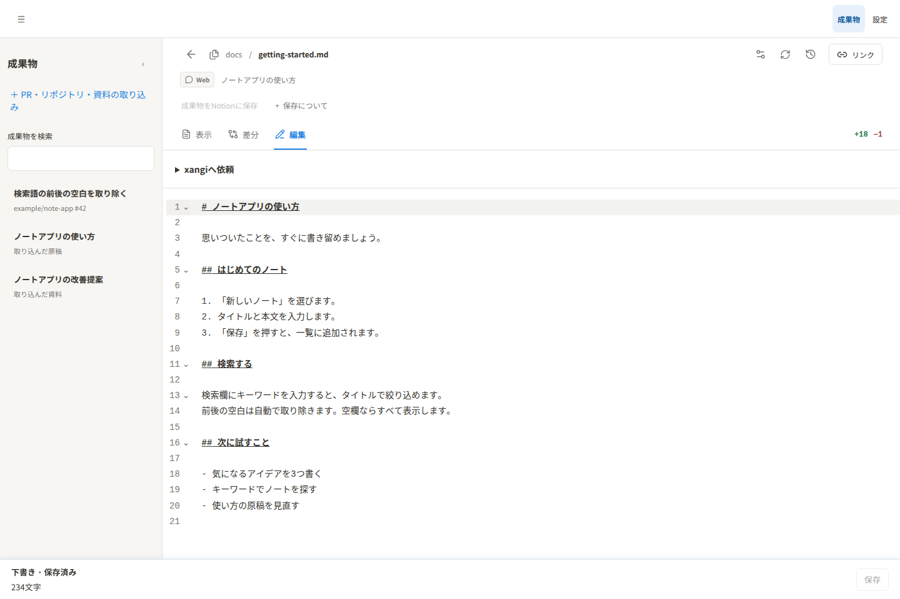

[日本語](../usage.md) | English

# Usage guide

## Install and register

Requires Node.js 22.12 or later, xangi with Managed Extensions, and a GitHub CLI account that can read the target PR. Confirm authentication with `gh auth status`.

Follow the [README Quickstart](../../README.en.md#quickstart) to install and register the extension.

Open xangi-studio from Extensions in the xangi Web UI. After updating the checkout, run `npm ci` and `npm run build`; restart the extension with `xangi extension restart xangi-studio` when server code changes.

## Read a GitHub PR

Open “Import PR or document” from the Artifacts page and enter a URL such as `https://github.com/owner/repo/pull/123`. Imported text is editable by default, including existing local and GitHub imports. Use Edit in the file detail view or edit the after side of the diff, then Save to update the xangi-studio copy. For explained diffs, open the full-file diff first. Saving does not write to the original repository, GitHub or Notion. Document views such as PDFs remain read-only. Saving clears earlier AI findings and overviews and rejects stale results. Reimporting the same upstream revision preserves edits. Opening a PR shows its changed-file list alongside one continuous diff for every file. Select a file in the list to jump to its changes, or use “Open file” for the existing detail view.

The continuous diff includes three unchanged lines around each change, with a different background color. Explanations and review findings appear immediately above their matching line, where you can continue the AI conversation. On mobile, the file list opens first and a button opens the continuous diff. PRs can be archived and restored from review settings.

“Check for updates” compares the base and head commits of that PR only. If they match the saved revision, no file is fetched again. If they differ, the new revision is imported and the old revision is hidden from the list while remaining accessible through existing links. For skipped files, the screen shows the count and the API response includes file names and reasons.

New imports and PR updates save the source and wait. “Review entire PR” covers the imported PR; “Review this file” covers only that file. The instruction field starts empty each time. Choose one or more reviewers in the same dialog. Completed findings appear beside their matching lines and link to their original AI conversation. Request work from xangi with explicit instructions. Viewing or saving requires no AI call.

## Import explanations and findings

When xangi or another reviewer has analyzed the changes, pass a PR URL and `analysis` keyed by file path to the `review.changes` capability:

```bash
xangi tool extension_request \
  --id xangi-studio \
  --capability review.changes \
  --path /import/github \
  --method POST \
  --body-json '{"url":"https://github.com/owner/repo/pull/123","analysis":{"src/example.ts":[{"heading":"Validate input","summary":"Trim whitespace","impact":"Saved values change","review":"Check empty input","severity":"warning","oldStart":10,"newStart":10}]}}'
```

Severity is `info`, `warning`, or `danger`. Explicit `analysis` updates explanations and findings even when the PR revision is unchanged. The import request immediately returns a job ID. Poll it until completion:

```bash
xangi tool extension_request \
  --id xangi-studio \
  --capability review.changes \
  --path /api/import/github/jobs/REPLACE_WITH_JOB_ID \
  --method GET
```

Job `status` is `running`, `completed`, or `failed`. On completion, `result.status` is `imported`, `updated`, or `unchanged`; `result.skipped` explains files that could not be imported.

PR imports include text dotfiles and dot directories, including `.env`, so leaked secrets can be reviewed. GitHub files are fetched across all 100-file pages; GitHub's 3,000-file API ceiling is reported rather than silently truncating results. Existing per-file size and change limits still apply.

## Ask about review results

“Ask AI about the results” opens the conversation that produced the review. Continue asking questions there. If no agent is selected, the review uses xangi's default backend, model, and workspace.

## Edit drafts

Open a draft from the artifact list, choose Edit, update the text, and press Save. Imported text is editable in the xangi-studio copy. Changes are not automatically applied to the source repository, GitHub or Notion.



Actual UI screenshot using a fictional note app's draft.

## Local development file comparison

A standalone server supports local file comparison and editing:

```bash
npm ci
npm run build
npm start
# In another terminal
npm run review -- link demo-markdown
```

It listens on `127.0.0.1:18930` by default and creates sample files in `workspace/`. Register a real file before the AI edits it:

```bash
npm run review -- begin drafts/example.md --title 'Shorten introduction' --source discord
# Edit the file, then:
npm run review -- link <returned-id> --mode diff
```

Use `--new` with `begin` to compare a new file against an empty baseline. Set `EDITOR_ROOT` for another folder and use a separate `EDITOR_STATE_DIR` for its state. `EDITOR_HOST`, `EDITOR_PORT`, and `EDITOR_BASE_URL` control the listener and shared link. The local edit key grants access to the whole trial server, so limit who receives it.

## Limits

- The GitHub CLI path only reads PR data; it does not comment, approve, merge, or push.
- Supported UTF-8 text files are limited to 256 KB each. Binary files, unsupported extensions, and oversized files appear in `skipped`.
- If xangi's answer cannot be parsed as file level JSON, the result is not applied to the cards. Open the linked xangi conversation to inspect it, then use the review confirmation to retry.

### AI review persistence and recovery

Before sending the review request, the UI registers its PR revision and xangi session ID with the extension. The extension collects the persisted assistant response and applies it only to that revision. Collection continues after browser disconnection or reload and resumes after extension restart. The UI displays running, completed, and failed states with a conversation link. A conversation that never starts fails after two minutes; a started conversation without a result fails after one hour. Use the review confirmation to retry.

The managed extension reads registered conversations from xangi’s `DATA_DIR/logs/sessions`, defaulting to `.xangi/logs/sessions` in the startup workspace. Custom transcript layouts and automatic collection in the standalone server are not supported. Jobs are persisted in the extension’s `state/review-jobs.json`. Stale PR results are rejected and retained as failed jobs.

## Document page reviews

Import PDF, PPTX, DOCX or DOC directly (100MB input; converted PDF up to 100MB / 100 pages). Install Poppler and LibreOffice on the server. Office files are converted automatically, preserving both the original file and rendered PDF. Office conversion times out after 60 seconds; each page command after 20 seconds. Import commits only after all pages are converted.

Paste a normal Google Slides or Docs URL (`https://docs.google.com/presentation/d/…` or `/document/d/…`) into the Google input. Optionally set `XANGI_REVIEW_GOOGLE_ACCOUNT` to a gog-authenticated account with Drive read access, `XANGI_REVIEW_GOG` if gog is not on PATH, and `GOG_KEYRING_PASSWORD` when required by the keyring. The account needs read/download permission on that document. Set `XANGI_REVIEW_SOFFICE` to override the default `libreoffice` executable.

Google imports only read/export the document; they never edit or comment on it. The source URL is retained. Google PDF exports have a separate upstream 10MB limit. Page numbers refer to the exported PDF, including pageless Google Docs. PPTX reviews refer to slides; Word reviews refer to rendered pages. Install matching fonts to minimize layout differences. OCR and GitHub binary import are not included.

Use previous/next or the page selector to inspect each page and its findings; mobile places findings below the image. Choosing Review explicitly starts the configured reviewers. Reviewers need local image-reading tools; those unable to inspect an image must mark appearance as unverified. Prompts include up to 8,000 extracted characters per page. Missing page results fail that reviewer's job.

After explicitly starting a review, keep the browser open until all reviewers have started. Results continue to be collected after closing it. Interrupted uploads expire after five minutes. Restarting during import requires importing again.

Google imports reuse the host workspace `skills/xs-google-workspace/scripts/gog_exec.py` credential wrapper. The optional account override takes precedence over `GOG_ACCOUNT`; otherwise registered Drive accounts are tried in order, continuing only on permission or expired-auth errors. Standalone mode uses existing gog settings and environment variables.

Google editor URLs pointing to PPTX, DOCX or DOC are also supported. The original Office file is downloaded, preserved locally and converted to PDF on the server without modifying the Drive file. This path does not use native Google PDF export.

Document reviews include a whole-document overview (purpose, audience and main topics) plus page summaries. The overview appears in the document list, review screen and Notion export. Existing reviews without an overview require a new AI review. Content summaries are distinct from review findings.

## Multiple reviewers

Reviewers run only after the user explicitly starts a review. The default and additional reviewers use independent sessions, deduplicated by agent ID. Importing or updating a PR or document never starts AI automatically.

Each reviewer has a separate status and conversation link. Findings are labeled with reviewer names and remain associated with the file/page; completion order never overwrites another reviewer. Each reviewer retains their latest successful result; failed reruns display failure while preserving prior findings. Notion snapshots include reviewer names.

## Optional Notion export

Set `XANGI_REVIEW_NOTION_PARENT_PAGE_ID` in the server environment. Authentication reuses `~/.config/notion/api_key`; set `XANGI_REVIEW_NOTION_TOKEN` only to override it. Grant the integration Insert Content access to the parent **page** (databases are not supported). Managed Extensions inherit these from the host environment; this app does not load `.env` automatically.

The Notion save button creates a child page containing reviews for the selected PR revision or all PDF pages. It returns a link, never sends automatically, and includes before/after source code and document page images with extracted text; original PDF files, transcripts and credentials are excluded. Unreviewed entries retain their current unreviewed status. Repeated saves of identical content reuse the existing page; changed reviews create a new snapshot. Images use direct Notion uploads; block requests are split below 100 blocks / 440KB, supporting 100-page documents.

Fix configuration before retrying authentication/permission failures; respect any displayed retry delay. Network errors and 5xx responses can be ambiguous, so automatic retries and duplicate exports are blocked. Check Notion and the matching pending record in `state/notion-exports.json`. Stop the service and back up that file before recording the confirmed saved `id`, `url`, and `status: "saved"`, or removing only the matching entry if no page was created.

The token stays on the server and is never sent to the browser.

The state directory may contain `notion-settings.json` with `{ "parentPageId": "parent-page-id" }`. The environment variable takes precedence. Do not store credentials in this file.

## Request work from xangi

Open an artifact file and expand **xangiへ依頼**. Select a project or agent, or use the host defaults, and enter instructions (required, up to 4,000 characters). Saved source content is limited to 90,000 characters. The request includes the saved content, file location and source. Apply pending file drafts before submitting. Imported text can be edited in the xangi-studio copy. For read-only documents such as PDFs, request a separate output file when changes are needed.

The same screen shows queued/running/completed/failed work and the answer. Open the xangi conversation to continue giving instructions. Follow-up conversation turns are tracked in that conversation. Answers are not automatically applied to artifact content; inspect the output location reported in the conversation and register it as an artifact when needed.

The host executes a normal Agent Run. Collection continues after closing the browser and resumes from persisted run IDs after extension restart. Unknown dispatch outcomes remain visible and are never automatically resubmitted; check host execution history before deciding what to do next.

## Navigation

The shared top navigation contains Artifacts and Settings. Import PRs/documents is available in the artifact sidebar.

Use Artifacts in the shared navigation to return from an artifact to the list. Unsaved edits require confirmation before leaving.

While a PR is open, the sidebar shows file search, changed files, and review/refresh/archive actions. PR identity, title, and file count stay in the main overview without a duplicate sidebar card or PR-level disclosure control.

Notion configuration lives in Settings in the shared navigation. Save the entire imported PR revision from the PR overview; individual files only offer Return to PR overview, not a whole-PR export action.

Shared back/forward controls use native browser history across the host, xangi-studio and artifacts. Existing unsaved-review guards remain in place. No separate URL history is stored. Browsers with the Navigation API disable unavailable directions; older browsers retain enabled controls backed by the standard History API.

## Artifact list and details

On desktop, search and select artifacts on the left and view PRs, documents and drafts on the right. Toggle the PR file list inside the detail pane. On phones, switch between the artifact list and details. Search persists within the tab; leaving unsaved edits requires confirmation.

## Declared access

Imports use GitHub CLI/gog and Poppler/LibreOffice. Requests use normal host Agent Runs and the selected agent settings, workspace and permissions. The extension collects review transcripts and request results. Notion export remains an explicit operation.

## Viewing and editing files

In the regular file view, navigation and controls scroll with the content. Return to the top or bottom of the page to switch modes or save. PR and repository overviews keep their existing pane layout.

Home, history, artifact navigation and settings share one navigation row. Open the file list with the arrow next to the filename. Expand the Notion save help to read the additional guidance.

## GitHub repository imports

Local repository snapshots saved from chat (`changeSet.kind: "workspace"`) are labeled “ローカルリポジトリ”. Opening a direct link or reloading opens the file list; selecting a file switches to its content. These snapshots do not sync with GitHub.

Authenticated `DELETE /api/reviews/:id` removes a Studio record without deleting its source file or other records. Active artifact requests, reviews of the same group, and Notion exports of the record return 409. Deletion is available through the API only.

Paste `https://github.com/owner/repo` into the GitHub import field. The default branch is used; `/tree/ref` selects a branch, tag or commit (not a folder). Imports pin a commit SHA and share the PR file tree, overview, file view, explicit whole/file review and refresh actions. Importing does not start AI. Repository snapshots display file content without diff coloring. The root README opens first; use the searchable file tree to read one file at a time. Markdown supports rendered/source views, while code has syntax highlighting and line numbers. Like the xangi file browser, the ☰ button in the list/content heading toggles the file pane. The file path appears only in the content heading; file count, commit and actions share a compact header. Desktop content expands to full width when the pane is closed. Mobile switches between the list and content, returning to content after file selection; it starts with content visible. Expand the selected file’s explanation/review section to read findings. Reviews fetch the pinned SHA. Same-revision imports preserve reviews; complete updates supersede older snapshots. Partial revisions remain separate in the UI.

Limits: 3,000 entries, 256KB per UTF-8 file, 20MB total. Empty and dot files are supported. Binary files, symlinks, submodules and failed reads are skipped; truncated GitHub trees reject the import. Private repositories require server-side GitHub CLI read access. No GitHub writes occur.

If a host without GitHub App auth inherits another instance’s App CLI wrapper in PATH, xangi-studio removes that wrapper only after the host explicitly reports that App auth is not configured. It uses the existing normal gh credentials, never another instance’s credentials. Enabled App auth, network failures and authentication errors do not switch identity.

### Working during imports

Starting a PR, repository or document import closes the dialog and displays a status message. Other artifacts remain accessible; imported content appears in the artifact list. Import requests time out after 60 seconds and result polling after 15 minutes. A wait timeout does not cancel server-side processing.

### PR and software overview diagrams

Open a PR or GitHub repository and select **概要・図解** to read its purpose, usage, before/after behavior (repository assumptions and behavior), components, relationships, human decision points, and limitations. File buttons open the supporting file; **ファイル** returns to the existing diff/source view.

**概要を作成** and **概要を生成する** run overview generation only, using one selected agent. They preserve existing review findings. Whole-PR/repository review runs independently and does not generate or consume this overview. Both operations may run at the same time; changing review instructions preserves the overview for the same revision.

Whole-set reviews partition imported files into at most three groups, balanced by imported text length and file count. Each selected reviewer gets a separate concurrent conversation for every group, including when only one reviewer is selected. A single file remains one group; splitting a huge file internally is not supported. Document page reviews retain their existing whole-document behavior. Successful groups are saved independently and survive other groups failing. Out-of-scope or missing-file answers fail without partial application, and failed retries preserve earlier successful findings. Started conversations are collected after the browser closes and after an extension restart.

AI output is neither human approval nor proof that tests ran. The view records revision, generation time, and agent. Results for an outdated revision are rejected; review results also require matching review instructions. Import a GitHub repository URL for software-level explanations. Coverage is limited to imported files.

### Autosaved editing drafts

Manual file edits autosave a draft after roughly 800ms without input. The save area shows draft status, errors, retry, a character count and Save. “下書き · 保存済み” means the draft is saved. Save writes the visible text directly to the file and draft, keeping the previous file in history. File and draft writes use last-write-wins without version checks or conflict locks. Unsaved browser recovery text is restored and saved as a draft without a manual recovery workflow. A failed draft request does not block explicit file saving. Requests use saved source content rather than pending drafts. The count includes whitespace and newlines (Unicode code points).

At widths up to 800px, the count, Save and retry controls follow the end of the document instead of floating over it. Scroll to the end to use them. This does not depend on keyboard or zoom detection. Draft autosave continues. Desktop widths retain the fixed bottom bar.

## HTML previews

Display renders HTML and HTM as pages, including HTML selected in the repository file list. Use Source to inspect the code. Edit the document and return to Display to preview an unsaved draft; Save still writes the xangi-studio copy. Use Reload preview after changing related files.

Self-contained HTML with styles/scripts and relative CSS, classic JavaScript and SVG references registered in the same import/revision are supported. External sites, CDNs, APIs, form submission, parent-page access and browser storage are blocked. Preview interactions and game progress are not persisted. JavaScript importing other modules and sources requiring a build are outside this preview; open a built self-contained HTML file. Missing images and external references are listed as unavailable.

The assembled HTML and related source files each have a 1MB limit. Temporary previews expire after ten minutes and are limited to twenty entries. Reload preview recreates an expired or failed preview. Creating a preview does not write source files, drafts or history.
