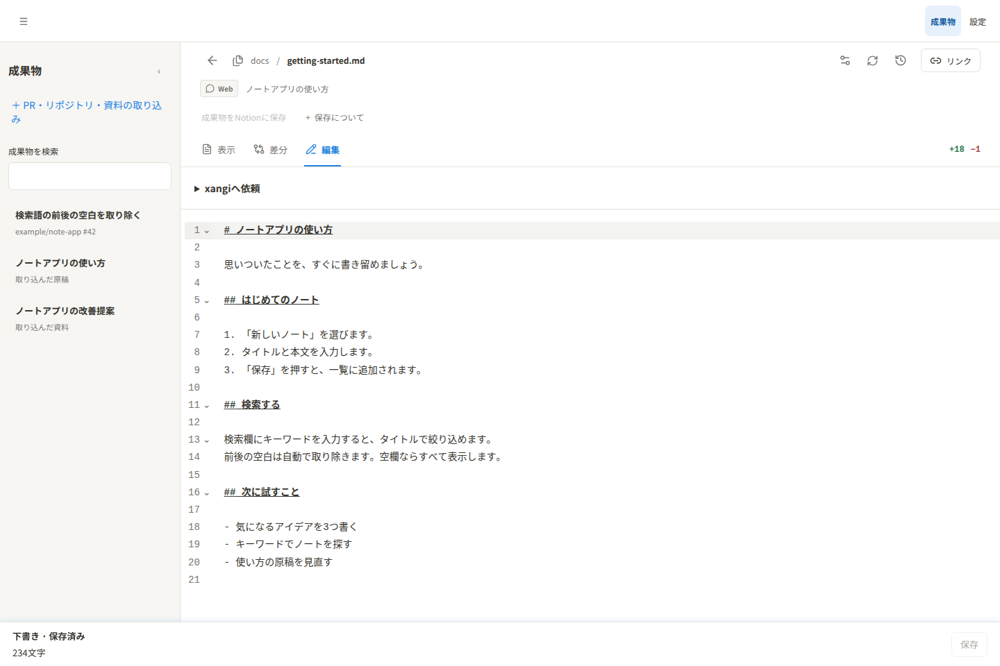

[English](en/usage.md) | 日本語

# 使い方ガイド

## 準備と登録

Node.js 22.12以降、xangiのManaged Extension機能、GitHub CLIが必要です。PRの読み取り権限を持つアカウントで`gh auth status`が成功することを確認します。

導入と登録は[READMEのQuickstart](../README.md#quickstart)を参照してください。

登録後、xangi Web UIのExtensionsから「xangi-studio」を開きます。更新時はこのcheckoutで`npm ci`、`npm run build`を実行し、サーバーコードも変更した場合は`xangi extension restart xangi-studio`で反映します。

## GitHub PRを読む

「成果物」画面の「PR・資料を取り込む」に`https://github.com/owner/repo/pull/123`形式のURLを入力します。取り込んだテキストは既定で編集できます。既存のローカル・GitHub取り込みも対象です。個別表示の「編集」、または差分の変更後本文を直し、「保存」でxangi-studio内のコピーへ反映します。説明付き差分では「ファイル全体を見る」から編集できます。元repo・GitHub・Notionへは自動反映しません。PDFなどの資料表示は閲覧専用です。保存後は編集前のAIレビュー・概要を消し、古い処理結果の反映を拒否します。同じ版を取り込み直しても編集内容を保持します。PRを開くと変更ファイル一覧とPR全体の差分を表示します。ファイル一覧から目的の変更へ移動できます。各ファイルの「個別表示」で従来の詳細画面も開けます。

PR全体の差分は変更前後の文脈を3行ずつ表示し、変更のない長い部分を省略します。説明・レビューは対象行の直前に表示し、その場所から同じAI会話へ質問できます。スマートフォンではまずファイル一覧を表示し、「全ファイルの差分を見る」で差分へ進みます。PRは一覧からアーカイブでき、レビュー設定から戻せます。

PR内のドットファイルやドットディレクトリ（`.env`を含む）もテキストとして取り込みます。PRに秘密情報が混入していないか確認してください。GitHub APIは100ファイルずつ全ページを取得します。APIの上限である3,000ファイルに達した場合は欠落を明示します。1ファイルの差分行数・本文サイズなど既存の上限は維持します。

一覧またはレビュー画面の「更新を確認」は、押したPRのbase/head commitだけを照合します。版が同じならファイルを再取得しません。変更があれば新版を取り込み、旧版は一覧から隠して既存リンクから読める状態を保ちます。取得できないファイルがある場合、画面には件数、APIの結果にはファイル名と理由を返します。

新規取り込み・PR更新後は原稿を表示して待機します。PR全体画面の「PR全体をレビュー」は取り込んだPR全体、各ファイルの「このファイルをレビュー」はそのファイルだけを対象にします。開始画面の指示は毎回空欄で、必要な観点だけ入力します。複数のレビュワーを選ぶと独立した会話で同時に確認します。結果は対象行へ保存され、そこから同じAI会話を開いて質問できます。「xangiへ依頼」では変更指示を入力します。

## 説明・レビューを一緒に取り込む

xangiなどが変更箇所を分析した場合は、`review.changes` capabilityにPR URLとファイル名をキーにした`analysis`を渡します。

```bash
xangi tool extension_request \
  --id xangi-studio \
  --capability review.changes \
  --path /import/github \
  --method POST \
  --body-json '{"url":"https://github.com/owner/repo/pull/123","analysis":{"src/example.ts":[{"heading":"入力の検証","summary":"空白を除去する","impact":"保存値が変わる","review":"空文字の扱いを確認する","severity":"warning","oldStart":10,"newStart":10}]}}'
```

`severity`は`info`、`warning`、`danger`です。`analysis`を明示した呼び出しでは、PRの版が同じでも説明とレビューを更新できます。取り込み要求はジョブIDをすぐ返します。次のコマンドで完了まで状態を確認してください。

```bash
xangi tool extension_request \
  --id xangi-studio \
  --capability review.changes \
  --path /api/import/github/jobs/REPLACE_WITH_JOB_ID \
  --method GET
```

ジョブの`status`は`running`、`completed`、`failed`です。完了時の`result.status`は`imported`、`updated`、`unchanged`のいずれかで、`result.skipped`には取り込めなかったファイルの理由が入ります。

## レビュー会話を続ける

レビューの進捗欄から、そのレビューを実行したxangi会話を開けます。結果について質問する場合は、同じ会話で続けてください。レビュワーを指定しなければxangi本体の既定backend・model・workspaceを使います。

## 原稿を編集する

成果物一覧から原稿を開き、「編集」で本文を直して「保存」を押します。取り込んだテキストもxangi-studio内のコピーを編集できます。元repo・GitHub・Notionへは自動反映しません。



架空のノートアプリの原稿を使った実画面です。

## ローカル開発用のファイル比較

Extensionとは別に、ローカルのファイル比較・編集サーバーを起動できます。

```bash
npm ci
npm run build
npm start
# 別の端末で
npm run review -- link demo-markdown
```

初期設定では`127.0.0.1:18930`で待ち受け、体験用の`workspace/`を作ります。実ファイルを比較するときは、AIによる編集の前に対象を登録します。

```bash
npm run review -- begin drafts/example.md --title '導入を短くする' --source discord
# ファイルを編集した後
npm run review -- link <返されたid> --mode diff
```

新規ファイルは`begin`に`--new`を付けると空の内容と比較できます。`EDITOR_ROOT`で対象フォルダを指定する場合は、状態の混同を避けるため`EDITOR_STATE_DIR`も分けてください。`EDITOR_HOST`、`EDITOR_PORT`、`EDITOR_BASE_URL`で待受先と利用者向けURLを設定できます。ローカル編集リンクのキーは、その試用サーバー全体の編集権限を持つため共有先を限定してください。

## 制約と確認方法

- PR取込はGitHub CLIで読み取りのみを行い、コメント・approve・merge・pushはしません。
- 対象はUTF-8の対応拡張子のテキストで、1ファイル256KBまでです。画像・バイナリ・非対応拡張子は`skipped`に理由を残します。
- xangiの返答がファイル別JSONとして読み取れない場合、結果はカードへ反映されません。画面に表示されるxangi会話で内容を確認し、レビュー実行の指示入力画面から再実行できます。

### AIレビュー結果の保存と復旧

AIレビュー開始前に、PRの版とxangi会話IDを拡張へ保存します。拡張はその会話の保存済み結果を読み取り、現行のPR版へ反映します。画面の再読み込み・通信切断後も回収を続け、拡張の再起動後は保存した処理を再開します。画面にはレビュー中・完了・失敗と会話リンクを表示します。開始できなかった会話は2分、結果が届かない会話は1時間で失敗として表示し、レビュー実行の指示入力画面から再実行できます。

Managed Extensionはxangiの`DATA_DIR/logs/sessions`（未指定時は起動workspaceの`.xangi/logs/sessions`）にある登録済み会話を読みます。独自のログ配置には対応しません。単独サーバーはAIレビュー結果の自動回収に対応しません。状態はExtension専用領域の`state/review-jobs.json`へ保存し、古いPR版の結果は適用せず失敗として残します。

## 資料のページレビュー

「資料ファイルを取り込む」でPDF・PPTX・DOCX・DOCを選択します。入力は100MB、変換後もPDF100MB・100ページまでです。サーバーにはPoppler（`pdfinfo`・`pdftoppm`・`pdftotext`）と、Office形式用のLibreOfficeが必要です。Office文書を利用者が事前にPDFへ変換する必要はありません。Office変換は60秒、各ページの画像・テキスト変換は各20秒でタイムアウトします。元のOfficeファイルと変換PDFを両方保持し、全ページの変換が済んでから登録します。

Googleスライド／GoogleドキュメントはURL欄へ通常の編集・共有URL（`https://docs.google.com/presentation/d/…` または `/document/d/…`）を入力します。次のサーバー設定が必要です。

- `XANGI_REVIEW_GOOGLE_ACCOUNT`: gogで認証済みのGoogleアカウント
- `XANGI_REVIEW_GOG`: gogの実行ファイル（省略時はPATH上の`gog`）
- `GOG_KEYRING_PASSWORD`: gogのkeyringに必要な場合に設定
- `XANGI_REVIEW_SOFFICE`: LibreOfficeの実行ファイル（省略時は`libreoffice`）

gogのDrive読み取り認証と、対象ファイルの閲覧・ダウンロード権限が必要です。Google資料は読み取りだけでPDFを取得し、元資料へコメントや編集を行いません。Google側のPDFエクスポートには別途10MBの制限があります。ページ番号は取り込んだPDFのページ番号で、Googleドキュメントのページ分けなし表示でもPDF出力時の区切りを使います。元のURLへのリンクを保持します。

「前のページ」「次のページ」とページ選択から移動し、画像とページに紐づく指摘を確認できます。スマホは画像の下にレビューを表示します。PPTXはスライド、Word文書は変換後のページ単位です。フォント不足等で元アプリとレイアウトが変わる場合があるため、サーバーのフォントも揃えてください。OCR・GitHub上のバイナリ取得は非対応です。

資料の取り込みだけではAIを実行しません。「レビューを開始」を選ぶと設定済みのレビュワー全員で確認します。画像を読めるツールと権限が必要で、画像を確認できないレビュワーには「見た目は未確認」と明記させます。抽出テキストはページごと最大8,000文字をプロンプトへ含めます。一部ページが欠けた結果はそのレビュワーの失敗として表示します。

明示的にレビューを開始した後、全レビュワーが開始するまでは画面を開いてください。開始後は画面を閉じても結果を回収します。アップロード中断は最大5分で期限切れ、取込中の拡張再起動は再取込が必要です。

Google連携はxangiのワークスペースにある `skills/xs-google-workspace/scripts/gog_exec.py` を自動利用し、既存の認証・keyring設定を再利用します。`XANGI_REVIEW_GOOGLE_ACCOUNT` は任意の固定アカウント指定です。未指定時は `GOG_ACCOUNT` を優先し、それもなければDrive認証済みアカウントを順に試します（権限不足・認証失効時のみ次へ進みます）。独立起動では既存gog設定と環境変数を使用します。

Googleの編集URLがPPTX・DOCX・DOCを指す場合も取り込めます。Driveから元のOfficeファイルを読み取り、サーバー上でPDFへ変換します。Google上の原本は変更せず、ローカルに原本を保持します。この経路はGoogle標準形式のPDFエクスポートを使いません。

資料のAIレビューでは、資料全体の目的・対象読者・主な論点と、各ページの内容の概要を作成します。全体概要は資料一覧・レビュー画面・Notion冒頭に表示します。過去のレビューに概要がない場合は「AIで再レビュー」後に表示されます。概要は改善指摘とは分けて扱います。

## 複数レビュワーでの確認

「レビューを開始」を明示的に選んだときだけ、既定レビュワー（未指定ならxangi本体の既定）と追加レビュワーを、それぞれ独立した会話で実行します。同じエージェントは重複起動しません。PRの取り込み・更新、資料の取り込みでは自動実行しません。

レビュワーごとの状態・会話リンクと、名前付きの指摘を表示します。最後に終わった人が他の人の指摘を上書きすることはありません。結果は各レビュワーの最後の成功分を保持し、再実行が失敗した場合は以前の結果を残しながら失敗状態を表示します。Notionにもレビュワー名付きの結果を保存します。

## Notion保存（任意）

サーバープロセスへ次の環境変数を設定し、保存先の**通常ページ**へNotion接続のコンテンツ挿入権限を付与します。DBは保存先にできません。Managed Extensionではホストxangiから拡張へ引き継がれる環境に設定してください。`.env.example`は設定名の例であり、このアプリ自身は`.env`を自動読込しません。

- `XANGI_REVIEW_NOTION_TOKEN`: 任意の認証上書き。未指定時は既存の `~/.config/notion/api_key` を使用
- `XANGI_REVIEW_NOTION_PARENT_PAGE_ID`: 保存先の親ページID

「コード・画像付きでNotionに保存」を押すと、選択中のPR版またはPDF全ページのレビューを新規子ページへ保存し、リンクを表示します。自動送信はしません。PRは変更前後のコード全文、資料は各ページの画像と抽出テキストを指摘と一緒に保存します。元PDFファイル・会話ログ・認証トークンは保存しません。未レビューの場合も現在表示している未実施の記述が保存されます。

同じ保存先・内容の再クリックは既存ページを返します。レビューが変われば新しいスナップショットを作ります。画像はNotionに直接アップロードし、本文は100ブロック・440KB以内に分割して保存します。100ページの資料にも対応します。認証・権限エラーは設定を修正後に再試行できます。429等で待機秒数が出た場合はその時間以上待ってください。

通信切断や5xxでは保存済みか判別できないため、自動再送せず以降の重複保存も止めます。Notion側で対象を検索し、`state/notion-exports.json`の該当pending記録を確認してください。保存済みならその記録へ`status: "saved"`と`id`・`url`を補い、未保存と確認できた場合だけバックアップ後に該当キーを除去します。作業時はサービスを停止し、他の保存と競合しないようにします。

認証トークンはブラウザへ送信しません。

保存先はstate領域の `notion-settings.json` に `{ "parentPageId": "親ページID" }` として保持することもできます。環境変数の指定を優先します。認証キーはこのファイルに保存しません。

## xangiへ依頼する

成果物一覧で原稿・資料・PRのファイルを開き、「xangiへ依頼」を開きます。プロジェクトまたはエージェントを選び、依頼内容（必須、4,000文字以内）を送信します。対象本文は90,000文字以内です。指定しなければxangiの既定設定を使います。

保存済みの本文・対象ファイル・出典を添えて、通常のxangi Agent Runへ依頼します。未反映の下書きがある場合は先に「保存」してください。取り込んだテキストはxangi-studio内のコピーを編集できます。PDFなどの閲覧専用資料は、修正が必要なら別ファイルへの保存を依頼します。

同じ画面で待機中・依頼中・完了・失敗と回答を確認できます。「xangiの会話を開く」で追加指示や相談を続けられます。追加の会話ターンの進捗は会話側で確認してください。回答を本文へ自動反映する機能はありません。変更結果は会話に記載された保存先で確認し、必要に応じて成果物として登録します。

画面を閉じてもホスト側で実行が続き、拡張は実行IDから結果を回収します。開始応答が不明な場合は「受付未確認」とし、自動再送しません。xangiの実行履歴を確認してから次の操作を決めてください。

## 画面の移動

上部の共通メニューは「成果物」「設定」です。「PR・資料の取り込み」は左の成果物一覧にあります。

成果物の詳細から一覧へ戻るときは、上部の共通メニュー「成果物」を使います。未保存の編集がある場合は、移動前に確認します。

PRを開いている間、左側は変更ファイルの検索・一覧とレビュー・更新・非表示の操作を表示します。PR名・タイトル・ファイル数は右側の概要にまとめ、左側に同じ情報やPR全体の開閉ボタンを重複表示しません。

共通メニューの「設定」にNotion保存先をまとめています。PR全体の画面で「PR全体をNotionに保存」を選ぶと、同じ版の取り込み済みファイル全体を保存します。個別ファイルには全体保存を置かず、個別表示からのみ「PR全体に戻る」を表示します。

共通ナビに「戻る」「進む」を追加しました。本体・xangi-studio・成果物をブラウザ標準履歴で往復します。独自のURL履歴は保存しません。未保存のレビュー編集がある場合は既存の確認を行います。Navigation API対応ブラウザでは履歴のない側を無効にし、非対応ブラウザではボタンを有効のまま標準History APIを使います。

## 成果物一覧と詳細

PCでは左の検索・成果物一覧から選び、右でPR・資料・原稿を確認します。PRのファイル一覧は右側の「ファイル一覧を開く／閉じる」で切り替えます。スマートフォンでは「成果物一覧を開く」「詳細に戻る」で切り替えます。検索語は同じタブ内で保持し、未保存の編集がある場合は移動前に確認します。

## アクセスの詳細

PR・資料の取得にはGitHub CLI・gog、文書変換にはPoppler・LibreOfficeを使います。依頼はホストの通常のAgent Runへ渡し、担当の設定・作業場所・権限に従います。レビュー会話ログと依頼の実行結果は拡張が回収します。Notion保存は明示操作で行います。

## ファイルの表示と編集

通常のファイル画面では、上部のナビゲーション・操作欄も本文と一緒にスクロールします。表示・差分・編集の切替や保存操作に戻るときは、ページの先頭または末尾へ移動してください。PR・リポジトリの全体画面は従来のペイン構成です。

上部のホーム・履歴・成果物一覧・設定は1行のナビゲーションにまとめています。ファイル一覧はファイル名横の矢印から開けます。Notion保存の補足は「保存について」を開いて確認できます。

## GitHubリポジトリの取り込み

チャットから保存したローカルリポジトリのスナップショット（`changeSet.kind: "workspace"`）は「ローカルリポジトリ」と表示します。直接リンクで開く・再読み込みするとファイル一覧を開き、ファイルを選ぶと本文へ切り替わります。GitHubとの同期は行いません。

古い成果物は認証済みAPIの `DELETE /api/reviews/:id` でStudioの登録から削除できます。元ファイルや別の登録は削除しません。実行中の依頼・同じグループのレビュー・対象のNotion保存がある場合は409で拒否します。画面からの削除操作はありません。

「取り込む」のGitHub欄へ `https://github.com/owner/repo` を入力します。既定ブランチを対象とし、`/tree/branch` でブランチ・タグ・コミットを指定できます（フォルダURLは対象外）。取り込み時にSHAを固定し、ファイル一覧、全体表示、個別表示、全体／ファイル別レビュー、更新確認をPRと共通の画面で利用できます。取り込みだけではAIを開始しません。

リポジトリは追加差分ではなく本文を表示します。ルートのREADMEを優先して開き、検索できるファイル一覧から1ファイルずつ閲覧できます。Markdownは整形表示とソース表示を切り替え、コードは色分け・行番号付きで表示します。xangi本体のファイル画面と同じく、一覧・本文の見出しにある☰ボタンで一覧ペインを開閉します。ファイルパスは本文の見出しだけに表示し、ファイル数・コミット・操作は上部にまとめています。PCでは一覧を閉じると本文が全幅に広がります。スマホでは一覧と本文を切り替え、ファイルを選ぶと本文に戻ります。スマホは本文表示で開始します。「説明・レビュー」を開くと選択ファイルの指摘を確認できます。レビューは画面のSHAを参照します。再取り込みで同じ版のレビューを保持し、完全取得した新しい版が旧版を置き換えます。途中取得の版はコミットごとに分離して表示します。

UTF-8テキスト（空ファイル・ドットファイルを含む）、1ファイル256KB、合計20MB、3,000ファイルが上限です。バイナリ、リンク、サブモジュール、取得失敗はスキップします。GitHubの一覧自体が省略される場合は取り込みを中止します。非公開リポジトリはサーバーのGitHub CLIに読み取り権限が必要です。GitHubへの書き込みは行いません。

GitHub Appを使わないxangiからxangi-studioを起動した際に、別インスタンスのApp用CLIラッパーがPATHへ残っている場合は、ホストが明示的に「App未設定」と返した時だけそのラッパーを外します。通常のGitHub CLIに登録済みの認証を使い、別インスタンスの認証は取得しません。App有効時・通信障害・認証エラー時には認証経路を切り替えません。

### 取り込み中の操作

PR・リポジトリ・資料の取り込み開始後はダイアログが閉じ、処理中の案内を表示します。他の成果物を閲覧でき、完成した内容は一覧に追加されます。通信は60秒、結果待ちは15分を上限にエラーを表示します。待機終了はサーバー側の取り込み中止を意味しません。

### PR・ソフトウェアの概要と図解

PRまたはGitHubリポジトリを開き、「概要・図解」に切り替えると、目的と使い方、変更前後（リポジトリは前提と動作）、構成要素と関係、人に確認したい判断点、未確認事項を表示します。図や判断点のファイル名から根拠のファイルへ移動できます。「ファイル」で従来の差分・ソース表示へ戻れます。

「概要を作成」または「概要を生成する」は概要専用の処理です。担当を1人選ぶと、レビューを実行せずに概要と図解を作成します。概要の再作成は既存のレビュー結果を変更しません。

「PR全体をレビュー」「リポジトリ全体をレビュー」は概要を生成・参照せず、取込済みファイルを最大3グループへ分けて同時に確認します。担当を1人選んでもグループごとに独立した会話を作り、複数選んだ場合は各担当が全グループを確認します。ファイル数と取込本文の長さで分割し、各会話は必要な関連コードを参照できます。1ファイルだけなら1グループです。巨大な1ファイルの内部を細分化する機能はありません。資料のページレビューは従来どおり全ページをまとめて確認します。

進捗と会話は処理の種類・担当・グループ別に表示します。各グループの成功分は個別に保存し、他グループの失敗で破棄しません。再実行が失敗した場合も以前の成功結果を保持します。割当外の結果や一部ファイルの欠落は失敗として表示します。開始済みの会話は画面を閉じた後も回収し、拡張の再起動後にも保存した結果を回収します。

概要の作成とレビューは相互に待つ必要がなく、それぞれ開始できます。レビュー指示を変更しても同じ版の概要は保持します。AI生成は人間の承認やテスト実行を意味しません。対象版・作成日時・担当を表示し、更新された版には旧結果を適用しません。レビューはレビュー指示の一致も検証します。ソフト全体はGitHubリポジトリURLを取り込んで利用します。概要・レビューは取込済みファイルに基づき、未取込ファイルの網羅を保証しません。

### 編集途中の自動保存

ファイルの手編集は入力が止まってから約800msで下書きを保存します。保存欄で保存状態・文字数・失敗・再試行を確認できます。「下書き · 保存済み」は下書きの保存です。「保存」を押すと、表示中の本文を元ファイルへ保存します。元の版が変わっていても比較・載せ直しの操作は不要です。他の変更は自動統合せず、保存前の本文を履歴に残します。再読込で下書きを復元します。別画面の下書きやブラウザの復旧本文との版照合は行わず、最後に保存した本文を採用します。ブラウザに未保存の本文があれば復元して下書きへ保存します。未保存の本文をxangiへの依頼には使いません。文字数はUnicodeコードポイント単位で、空白・改行を含みます。

スマホ・タブレット幅（800px以下）では、文字数と保存ボタンを画面へ固定せず、本文末尾に表示します。キーボードやズームの状態にかかわらず本文に重なりません。末尾までスクロールすると保存・再試行を操作できます。下書きの自動保存は続きます。PC幅では下部固定表示を維持します。

## HTMLのプレビュー

「表示」でHTML・HTMをページとして表示します。リポジトリのファイル一覧からHTMLを選んだ場合も同じ表示になり、「ソース表示」でコードへ切り替えられます。「編集」で本文を直してから「表示」へ戻ると、保存前の下書きもプレビューできます。「保存」は従来どおりxangi-studio内の本文へ反映します。関連ファイルを更新した場合は「プレビューを再読み込み」を押してください。

単体HTMLのスタイル・スクリプトと、同じ取り込み・同じ版に登録された相対CSS・通常のJavaScript・SVG参照を表示できます。外部サイト・CDN・APIへの通信、フォーム送信、親画面やブラウザの保存領域へのアクセスは許可しません。プレビュー内の操作やゲームの進行は保存されません。別のモジュールをimportするJavaScriptや、ビルドを必要とするソースは対象外です。ゲームなどはビルド済みの単体HTMLを開いてください。取り込まれていない画像・外部参照などは、読み込めない参照として表示します。

プレビュー本文と関連ファイルはそれぞれ最大1MBです。一時プレビューは10分・最大20件で失効します。期限切れや表示失敗時は「プレビューを再読み込み」で再作成できます。プレビュー作成だけでは原稿・下書き・履歴を書き換えません。
